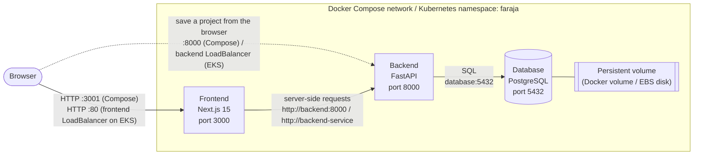
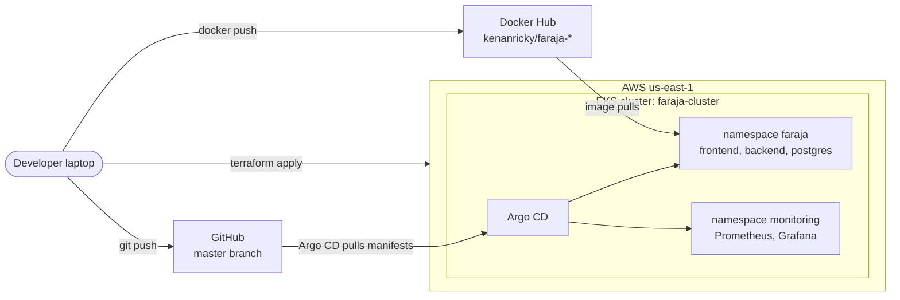

# Faraja: Government Project Accountability Platform

Faraja (Swahili for *comfort/relief*) is a three-tier web application for tracking how government projects are delivered. For each project it records the budget allocated and spent, the county and constituency, the implementing agency, the responsible politician, and the project's status. Milestones track progress over time.

The application is containerised with Docker, runs locally with Docker Compose, and is deployed to Kubernetes on **Amazon EKS**. **Terraform** builds the AWS network and cluster, **Argo CD** deploys the app from this repository (GitOps), and **Prometheus and Grafana** monitor it.

---

## Table of contents

1. [Architecture](#1-architecture)
2. [Services](#2-services)
3. [Repository layout](#3-repository-layout)
4. [Prerequisites](#4-prerequisites)
5. [Run locally with Docker Compose](#5-run-locally-with-docker-compose)
6. [How the Docker images are built](#6-how-the-docker-images-are-built)
7. [Image vulnerability scanning](#7-image-vulnerability-scanning)
8. [Push images to Docker Hub](#8-push-images-to-docker-hub)
9. [Deploy to Kubernetes on AWS EKS](#9-deploy-to-kubernetes-on-aws-eks)
10. [Verify the deployment and open the tools](#10-verify-the-deployment-and-open-the-tools)
11. [Stop and clean up](#11-stop-and-clean-up)
12. [Problems met and how they were fixed](#12-problems-met-and-how-they-were-fixed)
13. [Known limitations and next steps](#13-known-limitations-and-next-steps)
14. [Use of AI tools](#14-use-of-ai-tools)
15. [Author](#15-author)

---

## 1. Architecture



How a request flows:

1. The user opens the dashboard in a browser.
2. The **frontend** (Next.js) renders the page on the server. To list projects it calls the **backend** over the internal network, using the service name rather than `localhost`.
3. When the user saves a new project, the **browser** calls the backend directly, at the address baked into the frontend image (`NEXT_PUBLIC_API_BASE_URL`). The backend only accepts this from the frontend's address (CORS, `FRONTEND_ORIGIN`).
4. The **backend** (FastAPI) reads and writes data in **PostgreSQL** through SQLModel/SQLAlchemy.
5. PostgreSQL stores its data on a **persistent volume**, so the data survives container and pod restarts.

How it gets to AWS:



---

## 2. Services

| Service | Image | Container port | Exposed as | Role |
|---|---|---|---|---|
| Frontend | Compose `kenanricky/faraja-frontend:v1.1.0`; EKS `v1.4.0` | 3000 | Compose `localhost:3001`; Kubernetes LoadBalancer (AWS ELB, port 80) | Next.js dashboard: list projects, budget totals, create-project form |
| Backend | Compose `kenanricky/faraja-backend:v1.1.0`; EKS `v1.2.1` | 8000 | Compose `localhost:8000`; Kubernetes LoadBalancer `backend-service` (AWS ELB, port 80) | FastAPI REST API: `/projects`, `/milestones`, `/health`, `/metrics`, docs at `/docs` |
| Database (Compose) | `kenanricky/faraja-database:v1.1.0` | 5432 | Internal only | PostgreSQL 16 with the Faraja schema preloaded |
| Database (Kubernetes) | `postgres:15-alpine` + `init.sql` ConfigMap | 5432 | ClusterIP `database:5432` | PostgreSQL run as a StatefulSet on an EBS volume |

### Backend API

| Method | Path | Purpose |
|---|---|---|
| GET | `/health` | Health check, returns `{"status":"ok"}` |
| GET | `/projects` | List all projects (newest first) |
| GET | `/projects/{id}` | Get one project |
| POST | `/projects` | Create a project |
| PATCH | `/projects/{id}` | Update a project |
| DELETE | `/projects/{id}` | Delete a project |
| GET / POST | `/milestones` | List / create milestones |

Interactive API documentation is available at `http://localhost:8000/docs`.

---

## 3. Repository layout

```
faraja/
├── backend/                  FastAPI application
│   ├── app/                  api/, core/, db/, models/, schemas/, main.py
│   ├── Dockerfile            multi-stage, non-root
│   ├── .dockerignore
│   └── requirements.txt
├── frontend/                 Next.js (TypeScript) application
│   ├── app/, components/, lib/
│   ├── Dockerfile            multi-stage, standalone output, non-root
│   ├── .dockerignore
│   └── next.config.mjs       output: "standalone"
├── database/
│   ├── init.sql              schema: enum types, project and milestone tables
│   ├── Dockerfile            postgres:16-alpine + init.sql, non-root
│   └── .dockerignore
├── kubernetes/               Kubernetes manifests, deployed by Argo CD (see section 9)
├── terraform/                VPC, EKS cluster, node group and EBS CSI driver
│   ├── main.tf, variables.tf, providers.tf, output.tf
│   └── .terraform.lock.hcl   pinned provider versions
├── argocd/                   Argo CD Applications: faraja, faraja-monitoring, kube-prometheus-stack
├── monitoring/               ServiceMonitor, alert rules, Grafana dashboard (see monitoring/README.md)
├── docker-compose.yml        local three-tier stack
├── .env.example              template for .env (copy, then set a password)
└── README.md
```

---

## 4. Prerequisites

| Tool | Version used | Needed for |
|---|---|---|
| Docker Engine | 29.x | building and running containers |
| Docker Compose | v2+ (v5.6 used) | local stack |
| Git | any recent | cloning the repository |
| Trivy | 0.75 | vulnerability scanning (optional) |
| kubectl | 1.37 | Kubernetes deployment |
| Terraform | 1.5+ (1.16 used) | creating the VPC and EKS cluster |
| AWS CLI | v2 (2.38 used) | AWS authentication |
| An AWS account | n/a | EKS (this incurs cost, see section 9) |
| A Docker Hub account | n/a | hosting images that the cluster pulls |

Check the tools are installed:

```bash
docker --version && docker compose version
kubectl version --client
terraform version
aws --version
trivy --version
```

---

## 5. Run locally with Docker Compose

### 5.1 Clone the repository and create the `.env` file

```bash
git clone https://github.com/KenanRicky/faraja.git
cd faraja
cp .env.example .env
```

Open `.env` and set your own `POSTGRES_PASSWORD`. `.env` is git-ignored, so the real password never reaches GitHub.

| Variable | Default | Meaning |
|---|---|---|
| `POSTGRES_USER` | `postgres` | database user |
| `POSTGRES_PASSWORD` | `change-me` | database password (**change it**) |
| `POSTGRES_DB` | `faraja` | database name |
| `BACKEND_PORT` | `8000` | host port for the API |
| `FRONTEND_PORT` | `3001` | host port for the dashboard |
| `NEXT_PUBLIC_API_BASE_URL` | `http://localhost:8000` | API address the **browser** uses; built into the frontend image |

### 5.2 Build and start the stack

```bash
docker compose up -d --build
```

What happens:

1. Compose builds the three images from `./database`, `./backend` and `./frontend`.
2. It creates the network `faraja-net` and the volume `db-data`.
3. **database** starts first. On the first start of an empty volume, PostgreSQL runs `init.sql`, which creates the `project` and `milestone` tables.
4. **backend** waits until the database health check (`pg_isready`) passes, because of `depends_on: condition: service_healthy`. It then starts, and its own health check calls `/health`.
5. **frontend** waits until the backend is healthy, then starts.

The first start takes 1–2 minutes while PostgreSQL initialises.

### 5.3 How the Compose file is designed

| Requirement | How it is met |
|---|---|
| Explicit images and build paths | every service has `build:` and a versioned `image:` tag (`v1.1.0`) |
| Settings from `.env` | `${POSTGRES_USER}`, `${POSTGRES_PASSWORD}`, ports and the API URL are interpolated from `.env` |
| `.env.example` committed | yes; `.env` itself is git-ignored |
| Named network | `faraja-net`, used by all three services |
| Named volume | `db-data` mounted at `/var/lib/postgresql/data` |
| Restart policy | `restart: unless-stopped` on every service |
| Health checks | database: `pg_isready`; backend: HTTP `/health`; frontend: `wget` on `/` |
| Start order | `depends_on` with `condition: service_healthy` |
| Database not exposed | no `ports:` on the database, so it is reachable only inside the network |

Validate the file with:

```bash
docker compose config -q && echo "compose file is valid"
```

### 5.4 Verify the application is running

```bash
docker compose ps
```

All three services should show `(healthy)`. Then check each one:

```bash
# Backend health
curl http://localhost:8000/health
# -> {"status":"ok"}

# Create a project through the API
curl -X POST http://localhost:8000/projects \
  -H 'Content-Type: application/json' \
  -d '{"name":"Test road","description":"demo","county":"Nairobi",
       "budget_allocated":1000,"budget_spent":0,
       "start_date":"2026-01-01","target_end_date":"2026-12-31",
       "status":"planned","implementing_agency":"KeNHA","lead_politician":"N/A"}'

# List projects
curl http://localhost:8000/projects

# Check the logs for errors
docker compose logs --tail=50
```

Open **http://localhost:3001** in a browser. The new project appears in the dashboard and the budget totals include it.

### 5.5 Clean-start test

To prove the stack builds from scratch:

```bash
docker compose down -v --remove-orphans   # remove containers, network and volume
docker compose build --pull               # rebuild with fresh base images
docker compose up -d
docker compose ps                         # wait until all three are (healthy)
```

---

## 6. How the Docker images are built

Each Dockerfile was reviewed against this checklist:

| Check | Backend | Frontend | Database |
|---|---|---|---|
| Minimal base image | `python:3.12-slim-trixie` | `node:22-alpine` | `postgres:16-alpine` |
| Multi-stage build | ✅ builder → runtime | ✅ builder → runner | n/a (single layer on official image) |
| Dependencies copied before source (layer caching) | ✅ `requirements.txt` first | ✅ `package*.json` first | n/a |
| Package manager cache cleaned | ✅ `pip --no-cache-dir` | ✅ `npm cache clean --force` | n/a |
| `.dockerignore` | ✅ | ✅ | ✅ (only `init.sql` is sent) |
| Non-root user | ✅ `app` | ✅ `node` | ✅ `postgres` |
| Specific tags, not `latest` | ✅ | ✅ | ✅ |
| `LABEL maintainer` | ✅ | ✅ | ✅ |
| No secrets in the image | ✅ | ✅ | ✅ password supplied at runtime |

### 6.1 Backend (`backend/Dockerfile`)

- **Stage 1 (builder)** installs the Python packages from `requirements.txt` into `/install`.
- **Stage 2** starts from a clean slim image and copies only `/install` and the `app/` folder. Build tools and caches stay behind.
- A system user `app` is created, and the container runs as that user.
- Uvicorn serves the API on port 8000.

### 6.2 Frontend (`frontend/Dockerfile`)

- **Stage 1** runs `npm ci` and then `npm run build`. TypeScript is compiled here. `NEXT_PUBLIC_API_BASE_URL` is passed as a build argument because Next.js bakes it into the browser code.
- `next.config.mjs` sets `output: "standalone"`, so Next.js produces a minimal `server.js` with only the dependencies it needs.
- **Stage 2** copies just `.next/standalone` and `.next/static`, runs as the built-in `node` user, and starts `node server.js`.
- Result: the image dropped from **1.17 GB to about 350 MB**.

### 6.3 Database (`database/Dockerfile`)

- Based on the official `postgres:16-alpine` image.
- Copies `init.sql` into `/docker-entrypoint-initdb.d/`. PostgreSQL runs it automatically the first time it starts with an empty data directory.
- `POSTGRES_PASSWORD` is **not** set in the image. It comes from `.env` (Compose) or a Secret (Kubernetes).
- Runs as the `postgres` user. `gosu`, which is only needed when starting as root, is removed because Trivy flagged it (see section 7).

### 6.4 Database schema (`database/init.sql`)

- Enum types `projectstatus` (`planned`, `in_progress`, `delayed`, `completed`, `cancelled`) and `milestonestatus` (`not_started`, `in_progress`, `done`, `blocked`).
- Table `project`: name, description, county, constituency, budget allocated and spent (with `>= 0` checks), dates, status, implementing agency, lead politician, timestamps.
- Table `milestone`: linked to `project` by a foreign key, with title, detail, due and completed dates, and status.
- All statements use `IF NOT EXISTS`, so the script is safe to run again. The schema matches the backend's SQLModel models, so the backend's own table creation at startup finds the tables already there.

### 6.5 Build an image on its own

```bash
docker build -t kenanricky/faraja-backend:v1.1.0  ./backend
docker build -t kenanricky/faraja-database:v1.1.0 ./database
docker build -t kenanricky/faraja-frontend:v1.1.0 \
  --build-arg NEXT_PUBLIC_API_BASE_URL=http://localhost:8000 ./frontend
```

---

## 7. Image vulnerability scanning

All three images were scanned with Trivy:

```bash
trivy image --severity HIGH,CRITICAL kenanricky/faraja-backend:v1.1.0
trivy image --severity HIGH,CRITICAL kenanricky/faraja-frontend:v1.1.0
trivy image --severity HIGH,CRITICAL kenanricky/faraja-database:v1.1.0
```

### First scan: CRITICAL findings

| Image | Package | CVE | Cause |
|---|---|---|---|
| Backend | `libsqlite3-0`, `zlib1g` | CVE-2025-7458, CVE-2023-45853 | Debian 12 (bookworm) base, no fix available there |
| Frontend | `next` 14.2.15 | CVE-2025-29927 (middleware authorization bypass), CVE-2026-75604, GHSA-2xp9-vwfh-vxw4 | outdated Next.js |
| Database | `gosu` (Go stdlib 1.24.6) | CVE-2025-68121 | helper binary shipped in the official Postgres image |

### Fixes

| Image | Fix |
|---|---|
| Backend | moved the base image to `python:3.12-slim-trixie` (Debian 13) |
| Frontend | upgraded Next.js to `15.5.24` and React to `19`; the app needed no code changes |
| Database | removed `/usr/local/bin/gosu`; the container starts as `postgres`, so `gosu` is never used |

### Final scan

**0 CRITICAL** vulnerabilities in all three images.

---

## 8. Push images to Docker Hub

The Kubernetes cluster pulls the images from Docker Hub:

```bash
docker login
docker push kenanricky/faraja-backend:v1.1.0
docker push kenanricky/faraja-frontend:v1.1.0
docker push kenanricky/faraja-database:v1.1.0
```

Check an image exists on Docker Hub:

```bash
docker manifest inspect kenanricky/faraja-backend:v1.1.0 > /dev/null && echo "found"
```

The tags above are the ones used with Docker Compose. On EKS the cluster runs `faraja-backend:v1.2.1` and a frontend built with the cluster's backend address (`v1.4.0` at the time of writing); section 9.7 explains how that frontend image is built.

---

## 9. Deploy to Kubernetes on AWS EKS

The deployment has three layers:

1. **Terraform** (`terraform/`) creates the AWS infrastructure: a VPC, the EKS cluster `faraja-cluster`, two t3.medium worker nodes and the EBS CSI driver.
2. **Argo CD** runs inside the cluster and keeps it in sync with the `master` branch of this repository. Every `git push` to `kubernetes/` or `monitoring/` is deployed automatically within about 3 minutes.
3. **Kubernetes manifests** (`kubernetes/`) describe the app itself.

> **Cost:** about $0.27/hour (about $6.50/day) while the cluster runs: EKS control plane $0.10/hour, two t3.medium nodes about $0.08/hour, NAT gateway $0.045/hour plus data, and two load balancers about $0.05/hour. Tear it down when you are done (section 11).

### 9.1 What Terraform builds

| Resource | Details |
|---|---|
| VPC `faraja-vpc` | `10.0.0.0/16`, 3 private and 3 public subnets in us-east-1a/b/c |
| NAT gateway | One, so nodes in private subnets can pull images |
| EKS cluster `faraja-cluster` | Kubernetes 1.34, public API endpoint; whoever runs `terraform apply` becomes cluster admin |
| Managed node group `general` | t3.medium, 2 nodes (min 1, max 3), set by `desired_node_count` |
| EBS CSI driver | `aws-ebs-csi-driver` add-on, with `AmazonEBSCSIDriverPolicy` on the node role, so PVCs get EBS disks |
| Subnet tags | `kubernetes.io/role/elb` on public subnets, so AWS places the public load balancers there |

Terraform deliberately does **not** deploy the app. Argo CD does that, so the app is defined in one place only.

### 9.2 Kubernetes objects used

| File | Kind | Purpose |
|---|---|---|
| `namespace.yaml` | Namespace | `faraja` keeps all the app's objects together |
| `configmap.yaml` | ConfigMap `faraja-config` | non-secret settings: `POSTGRES_DB=faraja` and `FRONTEND_ORIGIN` (the frontend address allowed by CORS) |
| `secret.yaml.example` | Secret template | shows the shape of `faraja-secret`; the real one is created by hand and never committed |
| `postgres-init-configmap.yaml` | ConfigMap `postgres-init` | holds `init.sql`, mounted into the database pod |
| `persistentvolumeclaim.yaml` | PersistentVolumeClaim `faraja-pvc` | requests a 1 Gi `gp2` EBS disk for the database |
| `statefulset.yaml` | StatefulSet `postgres` | one PostgreSQL pod (`postgres-0`) with a stable identity and disk |
| `postgres-service.yaml` | Service `database` (ClusterIP) | stable internal address `database:5432` |
| `backend-deployment.yaml` | Deployment `backend` | 2 replicas; `DATABASE_URL` from the Secret, `FRONTEND_ORIGIN` from the ConfigMap; readiness check on `/health` |
| `backend-service.yaml` | Service `backend-service` (LoadBalancer) | port 80 → 8000; public so the browser can save projects; scraped by Prometheus |
| `frontend-deployment.yaml` | Deployment `frontend` | 2 replicas; `API_INTERNAL_URL=http://backend-service`; readiness check on `/` |
| `frontend-service.yaml` | Service `frontend-service` (LoadBalancer) | port 80 → 3000; AWS creates a public load balancer for it |

Design choices:

- **The database is a StatefulSet, not a Deployment.** A database needs one stable pod with its own disk. Two PostgreSQL replicas without replication would be two separate databases.
- **The database uses ClusterIP.** It is reachable only from inside the cluster.
- **The frontend and backend use LoadBalancer Services.** AWS creates a public load balancer with a stable hostname for each. The backend has to be public because the create-project form runs in the visitor's browser and calls the API directly.
- **CORS is restricted to the frontend's address.** `FRONTEND_ORIGIN` lets only the frontend's load balancer call the API from a browser.
- **Every container has resource requests and limits.** This lets the scheduler place pods correctly and stops one pod from starving the others.
- **Readiness probes** stop traffic from reaching a pod until it can actually serve requests.
- **`PGDATA` points to a subfolder** (`/var/lib/postgresql/data/pgdata`). A new EBS disk contains a `lost+found` folder, and PostgreSQL refuses to initialise into a directory that isn't empty.
- **Passwords live only in Secrets.** They are never in a committed file.

### 9.3 Create the cluster with Terraform

Push your latest commits first, because Argo CD deploys what is on GitHub, not what is on your laptop:

```bash
git push
```

Then create the infrastructure (about 15 minutes):

```bash
aws configure            # or: aws login
cd terraform
terraform init
terraform plan           # review what will be created
terraform apply          # type: yes
cd ..
```

Connect `kubectl` to the new cluster:

```bash
aws eks update-kubeconfig --region us-east-1 --name faraja-cluster
kubectl get nodes        # both nodes should be Ready
```

> **Why t3.medium and not t3.micro?** On EKS, a t3.micro can run only **4 pods**, a limit set by how many IP addresses AWS gives the instance, and it has about 500 MiB of memory. The cluster's own system pods fill all 4 slots, so application pods stay `Pending`. A t3.medium allows 17 pods and has 4 GiB of memory. See section 12.

### 9.4 Install Argo CD

```bash
kubectl create namespace argocd
kubectl apply -n argocd --server-side \
  -f https://raw.githubusercontent.com/argoproj/argo-cd/stable/manifests/install.yaml
kubectl wait -n argocd --for=condition=available deployment --all --timeout=300s
```

### 9.5 Create the Secrets

Secrets are not stored in git, so Argo CD cannot create them. Create them by hand **before** deploying, so the pods find them on first start:

```bash
# Database credentials for the app
kubectl create namespace faraja
kubectl create secret generic faraja-secret -n faraja \
  --from-literal=POSTGRES_USER=postgres \
  --from-literal=POSTGRES_PASSWORD='<your-password>' \
  --from-literal=DATABASE_URL='postgresql+psycopg://postgres:<your-password>@database:5432/faraja'

# Grafana admin login
kubectl create namespace monitoring
kubectl create secret generic grafana-admin -n monitoring \
  --from-literal=admin-user=admin \
  --from-literal=admin-password='<choose-a-password>'
```

- Use the **same password** in `POSTGRES_PASSWORD` and inside `DATABASE_URL`.
- `database` in the URL is the name of the PostgreSQL Service.
- Alternatively, copy `kubernetes/secret.yaml.example` to `kubernetes/secret.yaml` (git-ignored), fill in the password, and run `kubectl apply -f kubernetes/secret.yaml`.

### 9.6 Deploy everything through Argo CD

```bash
kubectl apply -f argocd/
kubectl get applications -n argocd -w     # wait until all three are Synced / Healthy
```

| Argo CD Application | Source | Deploys into |
|---|---|---|
| `faraja` | `kubernetes/` in this repo | `faraja` |
| `kube-prometheus-stack` | Helm chart `kube-prometheus-stack` 92.16.1 | `monitoring` |
| `faraja-monitoring` | `monitoring/` in this repo | `monitoring` |

All three use automated sync with `prune` and `selfHeal`: Argo CD removes objects deleted from git and reverts manual changes made with `kubectl`.

Kubernetes then:

1. creates the ConfigMaps, the PVC and the Services; AWS starts creating the two load balancers;
2. starts `postgres-0`. The PVC triggers the EBS driver to create and attach a 1 Gi disk, and PostgreSQL runs `init.sql` from the `postgres-init` ConfigMap;
3. starts the 2 backend replicas. Until the database is ready they may restart a few times;
4. starts the 2 frontend replicas.

At this point the dashboard opens and lists projects. Saving a project needs one more step.

### 9.7 Connect the browser to the new backend (needed after every new cluster)

The create-project form runs in the browser and calls the backend's load balancer directly. That address is **baked into the frontend image at build time**, and AWS gives the load balancers new hostnames every time the cluster is recreated. So after each new cluster:

1. Get the two new hostnames:
   ```bash
   kubectl get svc -n faraja backend-service frontend-service
   ```
2. Rebuild and push the frontend with the new **backend** hostname (use a new tag each time):
   ```bash
   docker build --build-arg NEXT_PUBLIC_API_BASE_URL=http://<backend-hostname> \
     -t kenanricky/faraja-frontend:<new-tag> ./frontend
   docker push kenanricky/faraja-frontend:<new-tag>
   ```
3. Update two files:
   - `kubernetes/frontend-deployment.yaml`: `image: kenanricky/faraja-frontend:<new-tag>`
   - `kubernetes/configmap.yaml`: `FRONTEND_ORIGIN: http://<frontend-hostname>` (`http`, no trailing slash)
4. Commit and push. Once Argo CD has synced, restart the backend so it reads the new CORS value:
   ```bash
   git commit -am "Point the frontend and CORS at the new load balancers" && git push
   kubectl rollout restart deployment backend -n faraja
   ```

To make Argo CD sync immediately instead of waiting up to 3 minutes, click **Refresh** in the Argo CD UI (section 10).

---

## 10. Verify the deployment and open the tools

```bash
kubectl get applications -n argocd
kubectl get pods,svc,pvc -n faraja
```

Expected:

```
faraja                  Synced   Healthy
faraja-monitoring       Synced   Healthy
kube-prometheus-stack   Synced   Healthy

pod/postgres-0               1/1  Running
pod/backend-xxxxx            1/1  Running
pod/backend-yyyyy            1/1  Running
pod/frontend-xxxxx           1/1  Running
pod/frontend-yyyyy           1/1  Running

service/database           ClusterIP      5432/TCP
service/backend-service    LoadBalancer   <xxxx>.us-east-1.elb.amazonaws.com   80:3xxxx/TCP
service/frontend-service   LoadBalancer   <yyyy>.us-east-1.elb.amazonaws.com   80:3xxxx/TCP

persistentvolumeclaim/faraja-pvc   Bound   1Gi   gp2
```

Check that the database ran the schema and the backend is reachable:

```bash
kubectl logs postgres-0 -n faraja | grep -E "init.sql|CREATE"
curl http://<backend-hostname>/health          # {"status":"ok"}
```

Check that CORS allows the frontend (this is what the browser does before saving a project):

```bash
curl -s -o /dev/null -D - -X OPTIONS http://<backend-hostname>/projects \
  -H "Origin: http://<frontend-hostname>" -H "Access-Control-Request-Method: POST" \
  | grep -i access-control-allow-origin        # must echo the frontend address
```

### Open the dashboard

Open `http://<frontend-hostname>` in a browser and add a project. Use plain **`http://`**: the load balancer only listens on port 80, and a browser that switches to `https://` will time out. A new load balancer takes 2–3 minutes before its DNS name resolves.

### Open Grafana and Argo CD

Neither is public. Reach them with a port-forward, each in its own terminal:

| Tool | Command | Address | Login |
|---|---|---|---|
| Grafana | `kubectl port-forward -n monitoring svc/monitoring-grafana 3001:80` | http://localhost:3001 | `admin` / the `grafana-admin` password |
| Prometheus | `kubectl port-forward -n monitoring svc/monitoring-kube-prometheus-prometheus 9090:9090` | http://localhost:9090 | none |
| Argo CD | `kubectl port-forward -n argocd svc/argocd-server 8443:443` | https://localhost:8443 (accept the self-signed certificate) | `admin` / see below |

```bash
kubectl -n argocd get secret argocd-initial-admin-secret -o jsonpath='{.data.password}' | base64 -d; echo
```

In Grafana, open **Dashboards → Faraja - Project Tracker Overview**. Metrics and alerts are described in [monitoring/README.md](monitoring/README.md). If a local port is already in use, pick another one (for example `3002:80`).

### See the resources in the AWS console

Set the console region to **US East (N. Virginia) us-east-1**, then go to **EKS → Clusters → faraja-cluster → Resources** and select the `faraja` namespace. The worker nodes are under **EC2 → Instances**, the load balancers under **EC2 → Load Balancers**, and the database disk under **EC2 → Volumes**.

### Useful troubleshooting commands

```bash
kubectl describe pod <pod-name> -n faraja    # Events at the bottom explain Pending/errors
kubectl logs <pod-name> -n faraja            # application logs
kubectl logs <pod-name> -n faraja --previous # logs from the last crashed container
kubectl get events -n faraja --sort-by=.lastTimestamp
kubectl rollout restart deployment/backend -n faraja
kubectl get application faraja -n argocd -o jsonpath='{.status.sync.revision}'   # commit Argo CD deployed
```

---

## 11. Stop and clean up

### Docker Compose

```bash
docker compose down        # stop and remove containers and the network (data is kept)
docker compose down -v     # also delete the database volume (all data is lost)
```

### EKS (stops AWS charges)

Tear down in this order. The load balancers and the EBS disk were created by Kubernetes, not Terraform, so they must be removed first or `terraform destroy` gets stuck on them.

```bash
# 1. Stop Argo CD from recreating anything
kubectl delete applications -n argocd --all

# 2. Remove the app and monitoring: deletes both load balancers and the EBS disk
kubectl delete namespace faraja monitoring

# 3. Destroy the cluster, nodes, NAT gateway and VPC (10–15 minutes)
cd terraform && terraform destroy      # type: yes

# 4. Check nothing is left
aws eks list-clusters --region us-east-1
aws elb describe-load-balancers --region us-east-1 --query 'LoadBalancerDescriptions[].LoadBalancerName'
```

Tearing down deletes all project data in PostgreSQL. To rebuild later, repeat section 9 from 9.3, including 9.7, because the load balancer addresses will be new.

---

## 12. Problems met and how they were fixed

| # | Problem | Cause | Fix |
|---|---|---|---|
| 1 | `docker build` of the database failed: `"/init.sql": not found` | The Dockerfile copied `init.sql`, but the file didn't exist | Wrote `database/init.sql` to match the backend's SQLModel models |
| 2 | Build warning `SecretsUsedInArgOrEnv` | `POSTGRES_PASSWORD` was hard-coded with `ENV` in the Dockerfile | Removed it; the password is supplied at runtime from `.env` or a Secret |
| 3 | The repository contained about 7,600 AWS CLI installer files and a 74 MB zip | They were committed by mistake with `git add .` | `git rm --cached`, then added `aws/`, `*.zip` and `.env.test` to `.gitignore` |
| 4 | Six CRITICAL CVEs | Old base images and Next.js 14 | See section 7 |
| 5 | Backend never started in Compose: "dependency database failed to start" | The database's first-time setup took longer than its health check allowed | Added `start_period: 60s` to the database health check |
| 6 | Frontend showed `unhealthy` while working | Inside Alpine, `localhost` resolves to IPv6 `::1`, but Next.js listens on IPv4 only | Health check uses `127.0.0.1` |
| 7 | Dashboard was empty inside containers | Server-side rendering called `localhost:8000`, which inside a container is the frontend itself | `lib/api.ts` uses `API_INTERNAL_URL` (`http://backend:8000` / `http://backend-service`) on the server |
| 8 | Kubernetes manifests had wrong ports and selectors | The frontend Service selected `app: backend`; the name `frontend-Service` used capitals (invalid); container ports didn't match the apps | Fixed the selectors, names and ports; added resource limits |
| 9 | `postgres-0` stuck in `Pending`: "Too many pods" | t3.micro nodes allow only 4 pods, all used by system pods | Replaced the node group with t3.medium |
| 10 | `faraja-pvc` stuck in `Pending` | The EBS CSI driver wasn't installed, so no disk could be created | Installed the `aws-ebs-csi-driver` add-on; Terraform now does this (section 9.1) |
| 11 | Backend `CreateContainerConfigError: secret "faraja-secret" not found` | The Secret hadn't been created on the new cluster | Created it with `kubectl create secret` (section 9.5) |
| 12 | Backend `CrashLoopBackOff` | The backend had no `DATABASE_URL`, so it tried `localhost:5432` | Deployment reads `DATABASE_URL` from the Secret |
| 13 | `kubectl apply` refused the StatefulSet: "updates to statefulset spec … are forbidden" | `serviceName` cannot be changed on an existing StatefulSet | Deleted and recreated the StatefulSet; the data is safe on the separate PVC |
| 14 | Risk: `kubectl apply -f kubernetes/` would overwrite the real Secret with the template password | The template was named `secret.example.yaml` | Renamed it to `secret.yaml.example` so `kubectl` skips it |
| 15 | The dashboard couldn't be opened in a browser from outside the cluster | The frontend Service was a `NodePort` (30090). EKS node security groups block that port by default, and the URL depended on a worker node's public IP, which changes when nodes are replaced | Changed `frontend-service` to `type: LoadBalancer`. AWS now creates a public load balancer on port 80 with a stable hostname (`kubectl get svc -n faraja`), with no security-group edits needed |
| 16 | `terraform validate` failed: "Duplicate variable declaration" | `aws_region` and `cluster_name` were declared in both `main.tf` and `variables.tf` | Kept them only in `variables.tf` |
| 17 | Cluster creation would be rejected | EKS 1.30 is no longer offered by AWS | Set `cluster_version = "1.34"` |
| 18 | `kubectl` and Terraform would get `Unauthorized` on the new cluster | Version 20 of the EKS module no longer makes the creator a cluster admin | Added `enable_cluster_creator_admin_permissions = true` |
| 19 | First `terraform plan` would fail | The Kubernetes and Helm providers read the cluster through data sources before it existed | Removed those providers and the app resources from Terraform; Argo CD deploys the app |
| 20 | Public load balancers might not be placed | Public subnets were tagged `kubernetes.io/role/public-elb`, which AWS ignores | Changed the tag to `kubernetes.io/role/elb` |
| 21 | Creating a project from the browser failed on EKS ("Could not save project") | The browser used the backend address baked into the image (`localhost:8000`, later the old cluster's load balancer); the backend was ClusterIP; CORS only allowed `localhost` | Backend Service set to LoadBalancer, frontend rebuilt with the new backend address (`v1.4.0`), `FRONTEND_ORIGIN` added (section 9.7) |
| 22 | A pushed commit was not deployed straight away | Argo CD polls GitHub every 3 minutes and had checked just before the push | Clicked **Refresh** in Argo CD (or wait); then restarted the backend to load the new ConfigMap |
| 23 | `kubectl port-forward ... 8080:443` failed: "address already in use" | Jenkins was using port 8080 on the laptop | Used another local port (8443 for Argo CD, 3001 for Grafana) |

---

## 13. Known limitations and next steps

- **The frontend must be rebuilt for every new cluster.** The backend address is baked into the frontend image, and load balancer hostnames change each time the cluster is recreated (section 9.7). Planned fix: send the form through the Next.js server (a Server Action or an `/api` proxy route) so the browser only talks to the frontend, the backend can go back to ClusterIP, and no rebuild or CORS change is needed.
- **No HTTPS.** Both load balancers serve plain HTTP on port 80.
- **The backend API is public.** Anyone with its address can call it; CORS only limits browsers.
- **Single database replica.** PostgreSQL runs as one pod. High availability would need replication, for example a PostgreSQL operator or Amazon RDS.
- **Secrets are created by hand.** A tool such as External Secrets Operator or Sealed Secrets would let Argo CD manage them too.
- **Planned Kubernetes work:**
  - Bash scripts to automate deployments and cluster health checks
  - Liveness probes
  - An Ingress (AWS Load Balancer Controller) with HTTPS and a custom domain
  - Authentication and role-based access

---

## 14. Use of AI tools

AI tools were used during this project to help **debug** problems with the Docker, Docker Compose and Kubernetes setup, and to help write **clear documentation**. All changes were tested and checked before being committed.

---

## 15. Author

**Ricky Kenan Abura** · GitHub: [@KenanRicky](https://github.com/KenanRicky)
