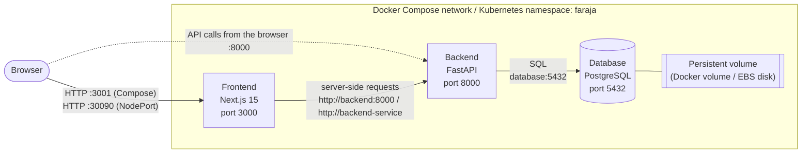

# Faraja: Government Project Accountability Platform

Faraja (Swahili for *comfort/relief*) is a three-tier web application for tracking how government projects are delivered. For each project it records the budget allocated and spent, the county and constituency, the implementing agency, the responsible politician, and the project's status. Milestones track progress over time.

The application is containerised with Docker, runs locally with Docker Compose, and is deployed to Kubernetes on **Amazon EKS**.

---

## Table of contents

1. [Architecture](#1-architecture)
2. [Services](#2-services)
3. [Repository layout](#3-repository-layout)
4. [Prerequisites](#4-prerequisites)
5. [Run locally with Docker Compose](#5-run-locally-with-docker-compose)
6. [How the Docker images are built](#6-how-the-docker-images-are-built)
7. [Image vulnerability scanning](#7-image-vulnerability-scanning)
8. [Push images to Docker Hub](#8-push-images-to-docker-hub)
9. [Deploy to Kubernetes on AWS EKS](#9-deploy-to-kubernetes-on-aws-eks)
10. [Verify the Kubernetes deployment](#10-verify-the-kubernetes-deployment)
11. [Stop and clean up](#11-stop-and-clean-up)
12. [Problems met and how they were fixed](#12-problems-met-and-how-they-were-fixed)
13. [Known limitations and next steps](#13-known-limitations-and-next-steps)
14. [Use of AI tools](#14-use-of-ai-tools)
15. [Author](#15-author)

---

## 1. Architecture



How a request flows:

1. The user opens the dashboard in a browser.
2. The **frontend** (Next.js) renders the page on the server. To list projects it calls the **backend** over the internal network, using the service name rather than `localhost`.
3. The **backend** (FastAPI) reads and writes data in **PostgreSQL** through SQLModel/SQLAlchemy.
4. PostgreSQL stores its data on a **persistent volume**, so the data survives container and pod restarts.

---

## 2. Services

| Service | Image | Container port | Exposed as | Role |
|---|---|---|---|---|
| Frontend | `kenanricky/faraja-frontend:v1.1.0` | 3000 | Compose `localhost:3001`; Kubernetes NodePort `30090` | Next.js dashboard: list projects, budget totals, create-project form |
| Backend | `kenanricky/faraja-backend:v1.1.0` | 8000 | Compose `localhost:8000`; Kubernetes ClusterIP `backend-service:80` | FastAPI REST API: `/projects`, `/milestones`, `/health`, docs at `/docs` |
| Database (Compose) | `kenanricky/faraja-database:v1.1.0` | 5432 | Internal only | PostgreSQL 16 with the Faraja schema preloaded |
| Database (Kubernetes) | `postgres:15-alpine` + `init.sql` ConfigMap | 5432 | ClusterIP `database:5432` | PostgreSQL run as a StatefulSet on an EBS volume |

### Backend API

| Method | Path | Purpose |
|---|---|---|
| GET | `/health` | Health check, returns `{"status":"ok"}` |
| GET | `/projects` | List all projects (newest first) |
| GET | `/projects/{id}` | Get one project |
| POST | `/projects` | Create a project |
| PATCH | `/projects/{id}` | Update a project |
| DELETE | `/projects/{id}` | Delete a project |
| GET / POST | `/milestones` | List / create milestones |

Interactive API documentation is available at `http://localhost:8000/docs`.

---

## 3. Repository layout

```
faraja/
├── backend/                  FastAPI application
│   ├── app/                  api/, core/, db/, models/, schemas/, main.py
│   ├── Dockerfile            multi-stage, non-root
│   ├── .dockerignore
│   └── requirements.txt
├── frontend/                 Next.js (TypeScript) application
│   ├── app/, components/, lib/
│   ├── Dockerfile            multi-stage, standalone output, non-root
│   ├── .dockerignore
│   └── next.config.mjs       output: "standalone"
├── database/
│   ├── init.sql              schema: enum types, project and milestone tables
│   ├── Dockerfile            postgres:16-alpine + init.sql, non-root
│   └── .dockerignore
├── kubernetes/               Kubernetes manifests (see section 9)
├── docker-compose.yml        local three-tier stack
├── .env.example              template for .env (copy, then set a password)
└── README.md
```

---

## 4. Prerequisites

| Tool | Version used | Needed for |
|---|---|---|
| Docker Engine | 29.x | building and running containers |
| Docker Compose | v2+ (v5.6 used) | local stack |
| Git | any recent | cloning the repository |
| Trivy | 0.75 | vulnerability scanning (optional) |
| kubectl | 1.37 | Kubernetes deployment |
| eksctl | 0.231 | creating the EKS cluster |
| AWS CLI | v2 (2.38 used) | AWS authentication |
| An AWS account | n/a | EKS (this incurs cost, see section 9) |
| A Docker Hub account | n/a | hosting images that the cluster pulls |

Check the tools are installed:

```bash
docker --version && docker compose version
kubectl version --client
eksctl version
aws --version
trivy --version
```

---

## 5. Run locally with Docker Compose

### 5.1 Clone the repository and create the `.env` file

```bash
git clone https://github.com/KenanRicky/faraja.git
cd faraja
cp .env.example .env
```

Open `.env` and set your own `POSTGRES_PASSWORD`. `.env` is git-ignored, so the real password never reaches GitHub.

| Variable | Default | Meaning |
|---|---|---|
| `POSTGRES_USER` | `postgres` | database user |
| `POSTGRES_PASSWORD` | `change-me` | database password (**change it**) |
| `POSTGRES_DB` | `faraja` | database name |
| `BACKEND_PORT` | `8000` | host port for the API |
| `FRONTEND_PORT` | `3001` | host port for the dashboard |
| `NEXT_PUBLIC_API_BASE_URL` | `http://localhost:8000` | API address the **browser** uses; built into the frontend image |

### 5.2 Build and start the stack

```bash
docker compose up -d --build
```

What happens:

1. Compose builds the three images from `./database`, `./backend` and `./frontend`.
2. It creates the network `faraja-net` and the volume `db-data`.
3. **database** starts first. On the first start of an empty volume, PostgreSQL runs `init.sql`, which creates the `project` and `milestone` tables.
4. **backend** waits until the database health check (`pg_isready`) passes, because of `depends_on: condition: service_healthy`. It then starts, and its own health check calls `/health`.
5. **frontend** waits until the backend is healthy, then starts.

The first start takes 1–2 minutes while PostgreSQL initialises.

### 5.3 How the Compose file is designed

| Requirement | How it is met |
|---|---|
| Explicit images and build paths | every service has `build:` and a versioned `image:` tag (`v1.1.0`) |
| Settings from `.env` | `${POSTGRES_USER}`, `${POSTGRES_PASSWORD}`, ports and the API URL are interpolated from `.env` |
| `.env.example` committed | yes; `.env` itself is git-ignored |
| Named network | `faraja-net`, used by all three services |
| Named volume | `db-data` mounted at `/var/lib/postgresql/data` |
| Restart policy | `restart: unless-stopped` on every service |
| Health checks | database: `pg_isready`; backend: HTTP `/health`; frontend: `wget` on `/` |
| Start order | `depends_on` with `condition: service_healthy` |
| Database not exposed | no `ports:` on the database, so it is reachable only inside the network |

Validate the file with:

```bash
docker compose config -q && echo "compose file is valid"
```

### 5.4 Verify the application is running

```bash
docker compose ps
```

All three services should show `(healthy)`. Then check each one:

```bash
# Backend health
curl http://localhost:8000/health
# -> {"status":"ok"}

# Create a project through the API
curl -X POST http://localhost:8000/projects \
  -H 'Content-Type: application/json' \
  -d '{"name":"Test road","description":"demo","county":"Nairobi",
       "budget_allocated":1000,"budget_spent":0,
       "start_date":"2026-01-01","target_end_date":"2026-12-31",
       "status":"planned","implementing_agency":"KeNHA","lead_politician":"N/A"}'

# List projects
curl http://localhost:8000/projects

# Check the logs for errors
docker compose logs --tail=50
```

Open **http://localhost:3001** in a browser. The new project appears in the dashboard and the budget totals include it.

### 5.5 Clean-start test

To prove the stack builds from scratch:

```bash
docker compose down -v --remove-orphans   # remove containers, network and volume
docker compose build --pull               # rebuild with fresh base images
docker compose up -d
docker compose ps                         # wait until all three are (healthy)
```

---

## 6. How the Docker images are built

Each Dockerfile was reviewed against this checklist:

| Check | Backend | Frontend | Database |
|---|---|---|---|
| Minimal base image | `python:3.12-slim-trixie` | `node:22-alpine` | `postgres:16-alpine` |
| Multi-stage build | ✅ builder → runtime | ✅ builder → runner | n/a (single layer on official image) |
| Dependencies copied before source (layer caching) | ✅ `requirements.txt` first | ✅ `package*.json` first | n/a |
| Package manager cache cleaned | ✅ `pip --no-cache-dir` | ✅ `npm cache clean --force` | n/a |
| `.dockerignore` | ✅ | ✅ | ✅ (only `init.sql` is sent) |
| Non-root user | ✅ `app` | ✅ `node` | ✅ `postgres` |
| Specific tags, not `latest` | ✅ | ✅ | ✅ |
| `LABEL maintainer` | ✅ | ✅ | ✅ |
| No secrets in the image | ✅ | ✅ | ✅ password supplied at runtime |

### 6.1 Backend (`backend/Dockerfile`)

- **Stage 1 (builder)** installs the Python packages from `requirements.txt` into `/install`.
- **Stage 2** starts from a clean slim image and copies only `/install` and the `app/` folder. Build tools and caches stay behind.
- A system user `app` is created, and the container runs as that user.
- Uvicorn serves the API on port 8000.

### 6.2 Frontend (`frontend/Dockerfile`)

- **Stage 1** runs `npm ci` and then `npm run build`. TypeScript is compiled here. `NEXT_PUBLIC_API_BASE_URL` is passed as a build argument because Next.js bakes it into the browser code.
- `next.config.mjs` sets `output: "standalone"`, so Next.js produces a minimal `server.js` with only the dependencies it needs.
- **Stage 2** copies just `.next/standalone` and `.next/static`, runs as the built-in `node` user, and starts `node server.js`.
- Result: the image dropped from **1.17 GB to about 350 MB**.

### 6.3 Database (`database/Dockerfile`)

- Based on the official `postgres:16-alpine` image.
- Copies `init.sql` into `/docker-entrypoint-initdb.d/`. PostgreSQL runs it automatically the first time it starts with an empty data directory.
- `POSTGRES_PASSWORD` is **not** set in the image. It comes from `.env` (Compose) or a Secret (Kubernetes).
- Runs as the `postgres` user. `gosu`, which is only needed when starting as root, is removed because Trivy flagged it (see section 7).

### 6.4 Database schema (`database/init.sql`)

- Enum types `projectstatus` (`planned`, `in_progress`, `delayed`, `completed`, `cancelled`) and `milestonestatus` (`not_started`, `in_progress`, `done`, `blocked`).
- Table `project`: name, description, county, constituency, budget allocated and spent (with `>= 0` checks), dates, status, implementing agency, lead politician, timestamps.
- Table `milestone`: linked to `project` by a foreign key, with title, detail, due and completed dates, and status.
- All statements use `IF NOT EXISTS`, so the script is safe to run again. The schema matches the backend's SQLModel models, so the backend's own table creation at startup finds the tables already there.

### 6.5 Build an image on its own

```bash
docker build -t kenanricky/faraja-backend:v1.1.0  ./backend
docker build -t kenanricky/faraja-database:v1.1.0 ./database
docker build -t kenanricky/faraja-frontend:v1.1.0 \
  --build-arg NEXT_PUBLIC_API_BASE_URL=http://localhost:8000 ./frontend
```

---

## 7. Image vulnerability scanning

All three images were scanned with Trivy:

```bash
trivy image --severity HIGH,CRITICAL kenanricky/faraja-backend:v1.1.0
trivy image --severity HIGH,CRITICAL kenanricky/faraja-frontend:v1.1.0
trivy image --severity HIGH,CRITICAL kenanricky/faraja-database:v1.1.0
```

### First scan: CRITICAL findings

| Image | Package | CVE | Cause |
|---|---|---|---|
| Backend | `libsqlite3-0`, `zlib1g` | CVE-2025-7458, CVE-2023-45853 | Debian 12 (bookworm) base, no fix available there |
| Frontend | `next` 14.2.15 | CVE-2025-29927 (middleware authorization bypass), CVE-2026-75604, GHSA-2xp9-vwfh-vxw4 | outdated Next.js |
| Database | `gosu` (Go stdlib 1.24.6) | CVE-2025-68121 | helper binary shipped in the official Postgres image |

### Fixes

| Image | Fix |
|---|---|
| Backend | moved the base image to `python:3.12-slim-trixie` (Debian 13) |
| Frontend | upgraded Next.js to `15.5.24` and React to `19`; the app needed no code changes |
| Database | removed `/usr/local/bin/gosu`; the container starts as `postgres`, so `gosu` is never used |

### Final scan

**0 CRITICAL** vulnerabilities in all three images.

---

## 8. Push images to Docker Hub

The Kubernetes cluster pulls the images from Docker Hub:

```bash
docker login
docker push kenanricky/faraja-backend:v1.1.0
docker push kenanricky/faraja-frontend:v1.1.0
docker push kenanricky/faraja-database:v1.1.0
```

Check an image exists on Docker Hub:

```bash
docker manifest inspect kenanricky/faraja-backend:v1.1.0 > /dev/null && echo "found"
```

---

## 9. Deploy to Kubernetes on AWS EKS

### 9.1 Kubernetes objects used

| File | Kind | Purpose |
|---|---|---|
| `namespace.yaml` | Namespace | `faraja` keeps all the app's objects together |
| `configmap.yaml` | ConfigMap `faraja-config` | non-secret settings: `POSTGRES_DB=faraja` |
| `secret.yaml.example` | Secret template | shows the shape of `faraja-secret`; the real one is created with `kubectl` |
| `postgres-init-configmap.yaml` | ConfigMap `postgres-init` | holds `init.sql`, mounted into the database pod |
| `persistentvolumeclaim.yaml` | PersistentVolumeClaim `faraja-pvc` | requests a 1 Gi `gp2` EBS disk for the database |
| `statefulset.yaml` | StatefulSet `postgres` | one PostgreSQL pod (`postgres-0`) with a stable identity and disk |
| `postgres-service.yaml` | Service `database` (ClusterIP) | stable internal address `database:5432` |
| `backend-deployment.yaml` | Deployment `backend` | 1 replica; gets `DATABASE_URL` from the Secret; readiness check on `/health` |
| `backend-service.yaml` | Service `backend-service` (ClusterIP) | port 80 → container port 8000, internal only |
| `frontend-deployment.yaml` | Deployment `frontend` | 2 replicas; `API_INTERNAL_URL=http://backend-service`; readiness check on `/` |
| `frontend-service.yaml` | Service `frontend-service` (NodePort) | port 80 → container port 3000, open on every node at **30090** |

Design choices:

- **The database is a StatefulSet, not a Deployment.** A database needs one stable pod with its own disk. Two PostgreSQL replicas without replication would be two separate databases.
- **The backend and database use ClusterIP.** They are reachable only from inside the cluster.
- **The frontend uses NodePort 30090.** This exposes the dashboard outside the cluster.
- **Every container has resource requests and limits.** This lets the scheduler place pods correctly and stops one pod from starving the others.
- **Readiness probes** stop traffic from reaching a pod until it can actually serve requests.
- **`PGDATA` points to a subfolder** (`/var/lib/postgresql/data/pgdata`). A new EBS disk contains a `lost+found` folder, and PostgreSQL refuses to initialise into a directory that isn't empty.
- **Passwords live only in the Secret.** They are never in a committed file.

### 9.2 Create the EKS cluster

> **Cost:** EKS charges about $0.10/hour for the control plane, plus about $0.04/hour for each t3.medium node. Delete the cluster when you are done (section 11).

```bash
# Log in to AWS
aws configure            # or: aws login

# Create the cluster with two t3.medium worker nodes (about 15–20 minutes)
eksctl create cluster \
  --name faraja \
  --region eu-west-1 \
  --nodegroup-name faraja-nodes-medium \
  --node-type t3.medium \
  --nodes 2 --nodes-min 2 --nodes-max 2 \
  --managed

# eksctl configures kubectl automatically; check it
kubectl config current-context
kubectl get nodes        # both nodes should be Ready
```

> **Why t3.medium and not t3.micro?** On EKS, a t3.micro can run only **4 pods**, a limit set by how many IP addresses AWS gives the instance, and it has about 500 MiB of memory. The cluster's own system pods fill all 4 slots, so application pods stay `Pending`. A t3.medium allows 17 pods and has 4 GiB of memory. See section 12.

### 9.3 Install the EBS storage driver

The database's PersistentVolumeClaim asks for an EBS disk (`storageClassName: gp2`). New EKS clusters cannot create EBS disks until the **EBS CSI driver** add-on is installed. The driver needs an IAM role so it is allowed to create volumes.

```bash
# 1. Let Kubernetes service accounts use IAM roles (OIDC provider)
eksctl utils associate-iam-oidc-provider --cluster faraja --region eu-west-1 --approve

# 2. Create the IAM role for the driver
eksctl create iamserviceaccount --cluster faraja --region eu-west-1 \
  --namespace kube-system --name ebs-csi-controller-sa \
  --role-name AmazonEKS_EBS_CSI_DriverRole --role-only \
  --attach-policy-arn arn:aws:iam::aws:policy/service-role/AmazonEBSCSIDriverPolicy \
  --approve

# 3. Install the add-on
eksctl create addon --cluster faraja --region eu-west-1 --name aws-ebs-csi-driver \
  --service-account-role-arn arn:aws:iam::$(aws sts get-caller-identity --query Account --output text):role/AmazonEKS_EBS_CSI_DriverRole \
  --force

# Check the driver pods are running
kubectl get pods -n kube-system | grep ebs-csi
```

### 9.4 Create the namespace and the Secret

The Secret is created from the command line, so the password never goes into a file in git:

```bash
kubectl apply -f kubernetes/namespace.yaml

kubectl create secret generic faraja-secret -n faraja \
  --from-literal=POSTGRES_USER=postgres \
  --from-literal=POSTGRES_PASSWORD='<your-password>' \
  --from-literal=DATABASE_URL='postgresql+psycopg://postgres:<your-password>@database:5432/faraja'
```

- Use the **same password** in `POSTGRES_PASSWORD` and inside `DATABASE_URL`.
- `database` in the URL is the name of the PostgreSQL Service.
- Alternatively, copy `kubernetes/secret.yaml.example` to `kubernetes/secret.yaml` (git-ignored), fill in the password, and run `kubectl apply -f kubernetes/secret.yaml`.

### 9.5 Deploy everything

```bash
kubectl apply -f kubernetes/
```

`kubectl` applies every `.yaml` file in the folder. `secret.yaml.example` is ignored because it doesn't end in `.yaml`, so the template can never overwrite the real Secret.

Kubernetes then:

1. creates the ConfigMaps, the PVC and the Services;
2. starts `postgres-0`. The PVC triggers the EBS driver to create and attach a 1 Gi disk, and PostgreSQL runs `init.sql` from the `postgres-init` ConfigMap;
3. starts the backend. Until the database is ready it may restart a few times, then it becomes `1/1 Running`;
4. starts the 2 frontend replicas.

Watch the pods start:

```bash
kubectl get pods -n faraja -w
```

---

## 10. Verify the Kubernetes deployment

```bash
kubectl get pods,svc,pvc -n faraja
```

Expected:

```
pod/postgres-0               1/1  Running
pod/backend-xxxxx            1/1  Running
pod/frontend-xxxxx           1/1  Running
pod/frontend-yyyyy           1/1  Running

service/database           ClusterIP  5432/TCP
service/backend-service    ClusterIP  80/TCP
service/frontend-service   NodePort   80:30090/TCP

persistentvolumeclaim/faraja-pvc   Bound   1Gi   gp2
```

Check that the database ran the schema:

```bash
kubectl logs postgres-0 -n faraja | grep -E "init.sql|CREATE"
```

End-to-end test inside the cluster (create a project, then check the frontend shows it):

```bash
kubectl exec -n faraja deploy/backend -- python -c "
import urllib.request, json
d = json.dumps({'name':'K8s test road','description':'cluster test','county':'Nairobi',
  'budget_allocated':1000,'budget_spent':0,'start_date':'2026-01-01',
  'target_end_date':'2026-12-31','status':'planned',
  'implementing_agency':'KeNHA','lead_politician':'N/A'}).encode()
r = urllib.request.urlopen(urllib.request.Request(
  'http://localhost:8000/projects', d, {'Content-Type':'application/json'}))
print('POST', r.status)"

kubectl exec -n faraja deploy/frontend -- wget -qO- http://frontend-service | grep -o "K8s test road"
```

This was tested on EKS: the POST returned `201` and the project appeared on the frontend page.

### Open the dashboard in a browser

```bash
kubectl get nodes -o wide       # note a node's EXTERNAL-IP
```

1. In the AWS console, go to **EC2 → Security Groups**, select the node group's security group, and add an inbound rule: **TCP 30090** from your IP.
2. Open `http://<node-external-ip>:30090`.

### See the resources in the AWS console

Set the console region to **Europe (Ireland) eu-west-1**, then go to **EKS → Clusters → faraja → Resources** and select the `faraja` namespace. The worker nodes are under **EC2 → Instances**, and the database disk under **EC2 → Volumes**.

### Useful troubleshooting commands

```bash
kubectl describe pod <pod-name> -n faraja    # Events at the bottom explain Pending/errors
kubectl logs <pod-name> -n faraja            # application logs
kubectl logs <pod-name> -n faraja --previous # logs from the last crashed container
kubectl get events -n faraja --sort-by=.lastTimestamp
kubectl rollout restart deployment/backend -n faraja
```

---

## 11. Stop and clean up

### Docker Compose

```bash
docker compose down        # stop and remove containers and the network (data is kept)
docker compose down -v     # also delete the database volume (all data is lost)
```

### Kubernetes

```bash
kubectl delete -f kubernetes/                    # remove the app
kubectl delete secret faraja-secret -n faraja
kubectl delete namespace faraja                  # remove everything left in the namespace
```

### Delete the EKS cluster (stops AWS charges)

```bash
eksctl delete cluster --name faraja --region eu-west-1
```

Afterwards, check in the AWS console (eu-west-1) that no EC2 instances, EBS volumes or load balancers are left behind.

---

## 12. Problems met and how they were fixed

| # | Problem | Cause | Fix |
|---|---|---|---|
| 1 | `docker build` of the database failed: `"/init.sql": not found` | The Dockerfile copied `init.sql`, but the file didn't exist | Wrote `database/init.sql` to match the backend's SQLModel models |
| 2 | Build warning `SecretsUsedInArgOrEnv` | `POSTGRES_PASSWORD` was hard-coded with `ENV` in the Dockerfile | Removed it; the password is supplied at runtime from `.env` or a Secret |
| 3 | The repository contained about 7,600 AWS CLI installer files and a 74 MB zip | They were committed by mistake with `git add .` | `git rm --cached`, then added `aws/`, `*.zip` and `.env.test` to `.gitignore` |
| 4 | Six CRITICAL CVEs | Old base images and Next.js 14 | See section 7 |
| 5 | Backend never started in Compose: "dependency database failed to start" | The database's first-time setup took longer than its health check allowed | Added `start_period: 60s` to the database health check |
| 6 | Frontend showed `unhealthy` while working | Inside Alpine, `localhost` resolves to IPv6 `::1`, but Next.js listens on IPv4 only | Health check uses `127.0.0.1` |
| 7 | Dashboard was empty inside containers | Server-side rendering called `localhost:8000`, which inside a container is the frontend itself | `lib/api.ts` uses `API_INTERNAL_URL` (`http://backend:8000` / `http://backend-service`) on the server |
| 8 | Kubernetes manifests had wrong ports and selectors | The frontend Service selected `app: backend`; the name `frontend-Service` used capitals (invalid); container ports didn't match the apps | Fixed the selectors, names and ports; added resource limits |
| 9 | `postgres-0` stuck in `Pending`: "Too many pods" | t3.micro nodes allow only 4 pods, all used by system pods | Replaced the node group with t3.medium |
| 10 | `faraja-pvc` stuck in `Pending` | The EBS CSI driver wasn't installed, so no disk could be created | Installed the `aws-ebs-csi-driver` add-on with an IAM role (section 9.3) |
| 11 | Backend `CreateContainerConfigError: secret "faraja-secret" not found` | The Secret hadn't been created on the new cluster | Created it with `kubectl create secret` (section 9.4) |
| 12 | Backend `CrashLoopBackOff` | The backend had no `DATABASE_URL`, so it tried `localhost:5432` | Deployment reads `DATABASE_URL` from the Secret |
| 13 | `kubectl apply` refused the StatefulSet: "updates to statefulset spec … are forbidden" | `serviceName` cannot be changed on an existing StatefulSet | Deleted and recreated the StatefulSet; the data is safe on the separate PVC |
| 14 | Risk: `kubectl apply -f kubernetes/` would overwrite the real Secret with the template password | The template was named `secret.example.yaml` | Renamed it to `secret.yaml.example` so `kubectl` skips it |

---

## 13. Known limitations and next steps

- **Creating a project from the browser on Kubernetes.** The frontend image was built with `NEXT_PUBLIC_API_BASE_URL=http://localhost:8000`. On the cluster the browser cannot reach that address, so the create-project form fails. Viewing projects works because that request runs on the server. Planned fix: add a proxy route in the frontend so the browser calls `/api/...` and the frontend forwards it to `backend-service`, then publish `v1.2.0`.
- **Single database replica.** PostgreSQL runs as one pod. High availability would need replication, for example a PostgreSQL operator or Amazon RDS.
- **Planned Kubernetes work:**
  - Prometheus and Grafana monitoring
  - Bash scripts to automate deployments and cluster health checks
  - Liveness probes
  - An Ingress or LoadBalancer instead of NodePort
  - Authentication and role-based access

---

## 14. Use of AI tools

**Claude Code** (Anthropic), used inside VS Code, assisted with this project. It was used to:

- diagnose the missing `init.sql` build error and write the schema to match the existing SQLModel models;
- review the Dockerfiles against the best-practice checklist and rewrite them as simple multi-stage, non-root builds;
- write `docker-compose.yml` with health checks, a named network, a volume and `depends_on` conditions;
- run Trivy scans and choose fixes for the CRITICAL CVEs (base image changes, the Next.js upgrade, removing `gosu`);
- review and simplify the Kubernetes manifests, fixing wrong ports, selectors, names and indentation;
- diagnose EKS problems: the t3.micro pod limit, the missing EBS CSI driver and the missing Secret;
- draft this README.

Every change was run and checked: Compose clean-start tests, Trivy rescans, and `kubectl` deployment and end-to-end tests on EKS. AWS changes that create IAM roles or cost money were reviewed and run by me.

---

## 15. Author

**Kenan Ricky** · GitHub: [@KenanRicky](https://github.com/KenanRicky)
